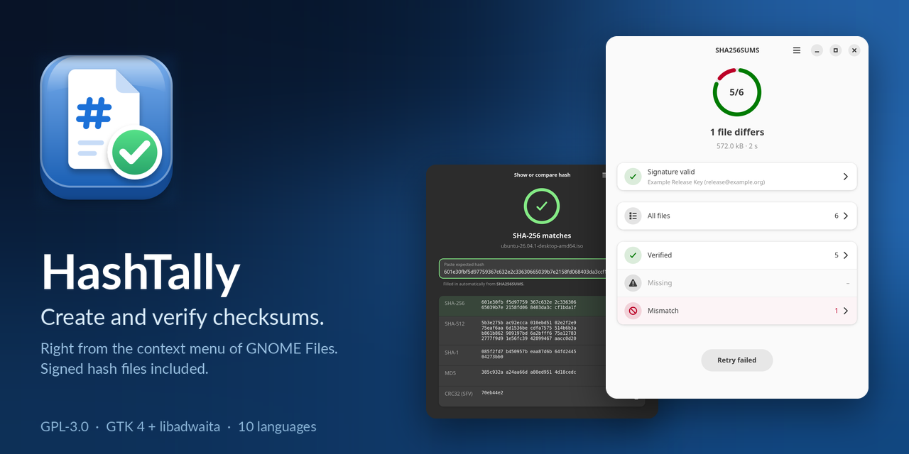
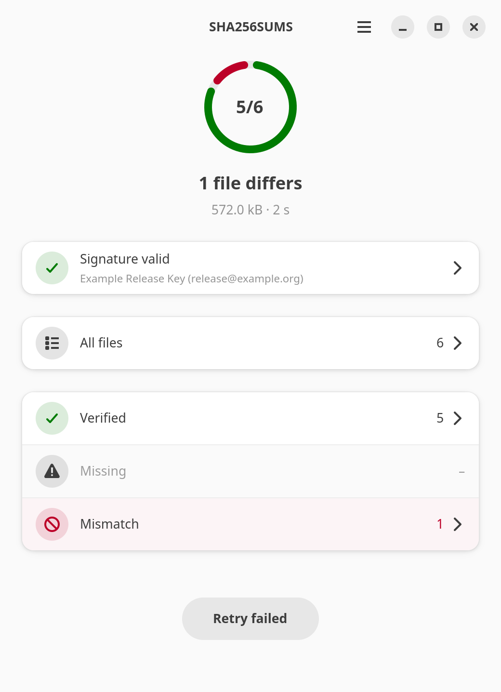
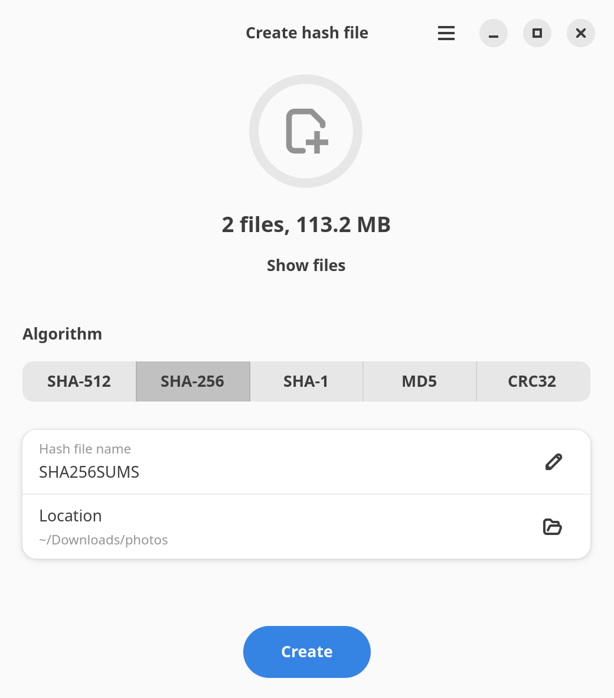
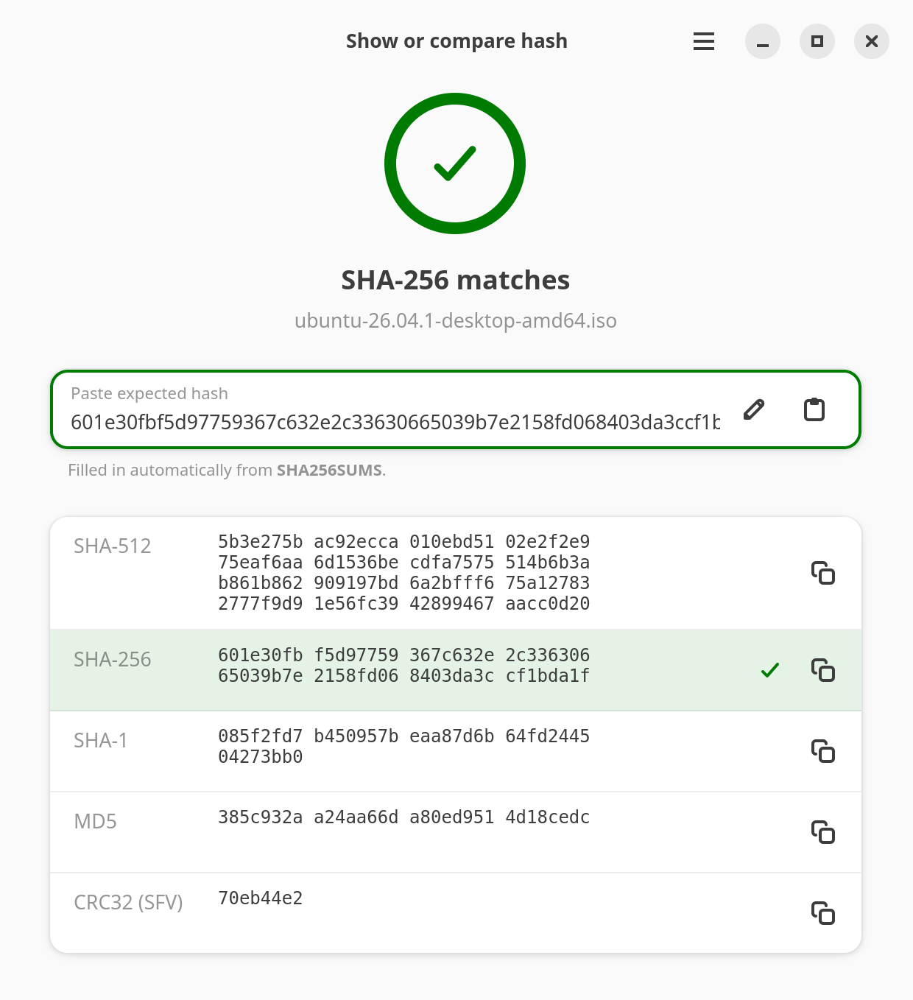

<p align="center">
  
</p>

# HashTally

[](https://github.com/DigitGram/hashtally/actions/workflows/test.yml)

**Create and verify checksums from the GNOME Files (Nautilus) context menu.** Inspired by the Windows
shell extensions [HashCheck](https://github.com/gurnec/HashCheck) and HashTab. To *tally* means to
match up, which is what comparing checksums does. Sister project of [TrustCopy](https://github.com/DigitGram/trustcopy).

<p align="center">
  
</p>

## What you get

- **Verify**: double-click a `.sha256`, `.sha1`, `.md5`, `.sfv` or `SHA256SUMS` file to check every file it lists. The verdict comes first, problems are grouped by kind, the files that are fine stay folded away.
- **Create**: right-click files or folders → *Scripts* → *HashTally: Create hash file*.
- **Compare**: show the hashes of one file, paste the expected one, see at once whether it matches.
- **GPG signatures**: also checks the signature of a hash file, the usual way Linux downloads are published (`SHA256SUMS` + `SHA256SUMS.gpg`, or a clear-signed file).
- **Native look**: GTK 4 and libadwaita, light and dark, in ten languages (English, Deutsch, Español, Français, Italiano, 日本語, Polski, Português (Brasil), Українська, 简体中文).

<p align="center">
  
  
</p>

## Requirements

- A GNOME-family desktop with **Nautilus** (Files), for example Ubuntu 24.04 or newer, Fedora 40 or newer, Debian 13 or newer, Linux Mint 22 or newer. **Nemo** (Cinnamon) and **Caja** (MATE), when installed, get the same Scripts entries
- Python 3.10+ as the system's `/usr/bin/python3`, GTK ≥ 4.14 and libadwaita ≥ 1.5 for Python (GNOME 46 and newer)
  - Debian/Ubuntu: `sudo apt install python3-gi gir1.2-adw-1`
  - Fedora: `sudo dnf install python3-gobject libadwaita`
  - Arch: `sudo pacman -S python-gobject libadwaita`
- Optional: `gpg` (package `gnupg`) for signature checks

Older systems are not supported; the installer stops with an install hint.

## Install

One line (installs for the current user only, no root):

```sh
curl -fsSL https://github.com/DigitGram/hashtally/releases/latest/download/install.sh | bash

# no curl (e.g. a fresh Ubuntu)? wget does the same:
wget -qO- https://github.com/DigitGram/hashtally/releases/latest/download/install.sh | bash
```

Prefer to read the script first? Download it, inspect it, then run it:

```sh
curl -fsSLO https://github.com/DigitGram/hashtally/releases/latest/download/install.sh
less install.sh && bash install.sh
```

Or from a checkout: `git clone https://github.com/DigitGram/hashtally && cd hashtally && ./install.sh`.
Running the one-line installer of a newer release updates an existing installation. If the right-click entries do not
show up, restart the file manager (`nautilus -q`, `nemo -q` or `caja -q`); log out and in once if the launcher or icon is missing.

To remove it:

```sh
~/.local/share/hashtally/install.sh --uninstall   # your settings in ~/.config/hashtally are kept
~/.local/share/hashtally/install.sh --purge       # removes the settings too
```

### Verify the download

Releases are signed with the key of `digitgram@proton.me`, fingerprint
`E7AA EB31 A4DE CF99 B314 7E1D FAAB 30B5 FD49 0E93`.

```sh
curl -fsSL https://github.com/DigitGram.gpg | gpg --import
curl -fsSLO https://github.com/DigitGram/hashtally/releases/latest/download/install.sh
curl -fsSLO https://github.com/DigitGram/hashtally/releases/latest/download/install.sh.asc
gpg --verify install.sh.asc install.sh
```

Run the script only if gpg reports a good signature and the fingerprint matches the one above. The signed script
names the exact commit it downloads, so the signature covers the program as well, not just the installer.

## Usage

| Action | How |
| --- | --- |
| Verify | Double-click a hash file, or right-click → *Open With HashTally* / Scripts → *HashTally: Verify hash file* |
| Create | Select files or folders → right-click → Scripts → *HashTally: Create hash file*. The file is named after the selection (`name.sha256`, or `SHA256SUMS` for several items); the name can be changed before creating |
| Compare | Select one file → right-click → Scripts → *HashTally: Show or compare hash*, then paste a hash (a whole line from a hash file works too) |
| Settings | Open **HashTally** from the Activities overview, or run `hashtally --settings` |

The *Scripts* entries are always listed, because Nautilus scripts cannot depend on the selection. All of them
start with "HashTally:"; if you prefer, the settings collect them in one *HashTally* submenu.
<kbd>Ctrl</kbd>+<kbd>W</kbd> or <kbd>Esc</kbd> closes any HashTally window.

### Command line

Started from a terminal, HashTally answers there, as text; started from the file manager or a launcher it opens the window.
`--gui` forces the window, `-q` leaves out the banner and the files that are fine.

```sh
hashtally SHA256SUMS                       # verify (the default when files are given)
hashtally --create ~/Downloads/*.iso       # writes SHA256SUMS; --algo, --output, --force
hashtally --compare ubuntu.iso             # print the hashes
hashtally --compare ubuntu.iso 3a7b...     # does this hash match?
hashtally --settings                       # always the window
```

Exit code: 0 all fine, 1 a mismatch, an error or a forged signature, 2 the command could not run. See `hashtally --help` for all options.

### Signature check

When a signature lies next to the hash file (`.gpg`, `.sig`, `.asc`, `.sign`) or the file is clear-signed, HashTally runs
`gpg --verify` and shows the result right below the verdict. **Compare the fingerprint** with the one on the publisher's website:
a valid signature only proves which key signed, not whose key it is. An invalid signature or a revoked key decides the verdict.
HashTally changes your keyring only when you press "Import key" and confirm.

### Supported hash files

GNU (`sha256sum` output), BSD (`SHA256 (file) = hash`), SFV and files that contain only a digest (`file.iso.sha256`).
Algorithms: SHA-256, SHA-512, SHA-1, MD5, CRC32 (plus SHA-224/384 and BLAKE2b for verifying).

More detail on the verification window, the signature results, supported formats and limits: [docs/details.md](docs/details.md).

## Translating

Translations are plain gettext `.po` files in `po/`, read directly at runtime. German is maintained by the author.
All other translations were generated by an AI assistant and have not been reviewed by native speakers;
corrections are welcome as pull requests. How to add a language: [docs/development.md](docs/development.md#translating).

## Development

Project layout, how it works, running the tests and trying every window by hand: [docs/development.md](docs/development.md).

## How it was made

HashTally is developed and maintained by DigitGram. The project is shaped by its requirements, design decisions and ongoing development.

AI-assisted tools were used during implementation and to support code quality improvements, testing, hardening and translations. All changes are reviewed and tested by the author, who is responsible for the final result.

The code is open, the test suite is available in `tests/`, and issues and pull requests are welcome.

## Support

HashTally is free and stays free. If it is useful to you, you can support its development on [Liberapay](https://liberapay.com/DigitGram). Donations are voluntary and unlock nothing.

## License

Copyright (C) 2026 DigitGram. HashTally is free software: you can redistribute it and/or
modify it under the terms of the [GNU General Public License](LICENSE) as published by the
Free Software Foundation, either version 3 of the License, or (at your option) any later
version. It comes without any warranty. The icon is part of the project and under the same license.
