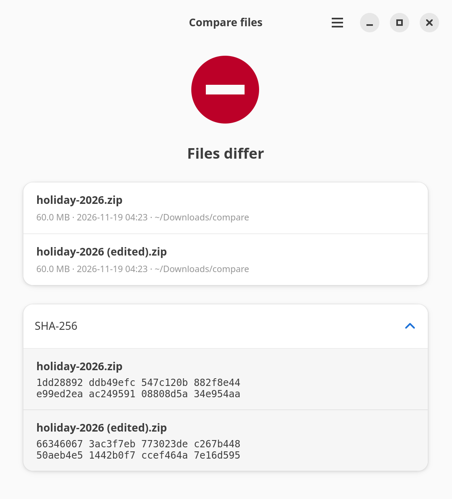

<p align="center">
  
</p>

<h1 align="center">HashTally</h1>

<p align="center">
  Create and verify checksums from the <b>GNOME Files (Nautilus) context menu</b>.<br>
  Double-click a hash file to check it, right-click files to create one. Installs for your user, no root needed.
</p>

<p align="center">
  <a href="https://github.com/DigitGram/hashtally/actions/workflows/test.yml"></a>
  <a href="LICENSE"></a>
  <a href="https://github.com/DigitGram/hashtally/releases/latest"></a>
</p>

<p align="center">
  <a href="#install"><b>Install</b></a> ·
  <a href="#usage">Usage</a> ·
  <a href="#verify-the-download">Verify the download</a> ·
  <a href="https://digitgram.github.io/hashtally/">Website</a> ·
  <a href="#support">Support</a>
</p>

<p align="center">
  
</p>

Inspired by the Windows shell extensions [HashCheck](https://github.com/gurnec/HashCheck) and HashTab. To *tally* means to
match up, which is what comparing checksums does. Sister project of [TrustCopy](https://github.com/DigitGram/trustcopy).

## Contents

- [What you get](#what-you-get)
- [Requirements](#requirements)
- [Install](#install)
- [Verify the download](#verify-the-download)
- [Usage](#usage)
- [Command line](#command-line)
- [Signature check](#signature-check)
- [Supported hash files](#supported-hash-files)
- [Translating](#translating)
- [Development](#development)
- [How it was made](#how-it-was-made)
- [Support](#support)
- [License](#license)

## What you get

- **Verify**: double-click a `.sha256`, `.sha1`, `.md5`, `.sfv` or `SHA256SUMS` file to check every file it lists. The verdict comes first, problems are grouped by kind, the files that are fine stay folded away.
- **Create**: right-click files or folders → *Scripts* → *HashTally: Create hash file*.
- **Compare**: show the hashes of one file, paste the expected one, see at once whether it matches. Select two files instead to see whether they are identical.
- **Update**: when the hash file you create already exists, add only the new and changed files to it instead of hashing everything again.
- **Not listed**: optional (off by default): when verifying, also counts the files in the list's folders that the list does not name, so a file added since the list was made does not go unnoticed.
- **Speed test**: in the settings, shows which algorithm is fastest on your computer and recommends the fastest secure one.
- **GPG signatures**: also checks the signature of a hash file, the usual way Linux downloads are published (`SHA256SUMS` + `SHA256SUMS.gpg`, or a clear-signed file).
- **Your menu**: the entries sit under *Scripts*, or, with the `python3-nautilus` package, in an entry of their own that shows only what fits the selection and that you can rename (a switch in the settings).
- **Native look**: GTK 4 and libadwaita, light and dark, in ten languages (English, Deutsch, Español, Français, Italiano, 日本語, Polski, Português (Brasil), Українська, 简体中文).

<p align="center">
  <picture>
    <source media="(prefers-color-scheme: dark)" srcset="docs/screenshots/compare-dark.png">
    
  </picture>
  <picture>
    <source media="(prefers-color-scheme: dark)" srcset="docs/screenshots/differ-dark.png">
    
  </picture>
</p>

<p align="center"><sub>More screenshots on the <a href="https://digitgram.github.io/hashtally/#gallery">project website</a>.</sub></p>

## Requirements

- A GNOME-family desktop with **Nautilus** (Files), for example Ubuntu 24.04 or newer, Fedora 40 or newer, Debian 13 or newer, Linux Mint 22 or newer. **Nemo** (Cinnamon) and **Caja** (MATE), when installed, get the same Scripts entries
- Python 3.10+ as the system's `/usr/bin/python3`, GTK ≥ 4.14 and libadwaita ≥ 1.5 for Python (GNOME 46 and newer)
  - Debian/Ubuntu: `sudo apt install python3-gi gir1.2-adw-1`
  - Fedora: `sudo dnf install python3-gobject libadwaita`
  - Arch: `sudo pacman -S python-gobject libadwaita`
- Optional: `gpg` (package `gnupg`) for signature checks

Older systems are not supported; the installer stops with an install hint.

## Install

Two ways, pick one. Releases are [signed](#verify-the-download).

| | For | Installs | Needs |
| --- | --- | --- | --- |
| [Install script](#install-script-for-your-user) | any distribution | for your user, `~/.local` | no root |
| [.deb](#debian-ubuntu-linux-mint-the-deb) | Debian, Ubuntu, Linux Mint | for the whole system | `sudo` |

### Install script, for your user

The script needs no root and refuses to run under `sudo`. It downloads exactly the version it belongs to.

Read it first, then run it:

```sh
curl -fsSLO https://github.com/DigitGram/hashtally/releases/latest/download/install.sh
less install.sh && bash install.sh
```

Or the short way, if you trust the signed release:

```sh
curl -fsSL https://github.com/DigitGram/hashtally/releases/latest/download/install.sh | bash

# no curl (e.g. a fresh Ubuntu)? wget does the same:
wget -qO- https://github.com/DigitGram/hashtally/releases/latest/download/install.sh | bash
```

Or from a checkout: `git clone https://github.com/DigitGram/hashtally && cd hashtally && ./install.sh`.
Running the one-line installer of a newer release updates an existing installation. The settings can also check for a newer version once a week, if you switch that on; nothing is sent or installed. If the right-click entries do not
show up, restart the file manager (`nautilus -q`, `nemo -q` or `caja -q`); log out and in once if the launcher or icon is missing.

To remove it:

```sh
~/.local/share/hashtally/install.sh --uninstall   # your settings in ~/.config/hashtally are kept
~/.local/share/hashtally/install.sh --purge       # removes the settings too
```

### Debian, Ubuntu, Linux Mint: the .deb

If you would rather not use a terminal: download `hashtally_<version>_all.deb` from the
[latest release](https://github.com/DigitGram/hashtally/releases/latest) and open it with a double click (Software or
*Install*), or from a terminal:

```sh
sudo apt install ./hashtally_<version>_all.deb   # pulls in GTK 4 and libadwaita
```

The package installs for all users, below `/usr`. The right-click entries sit in each user's own home folder, which a
package cannot write to: HashTally creates them when you open it for the first time (find it in the Activities overview);
restart the file manager (`nautilus -q`) if it asks. Do not combine it with the install script above: use one of them.

To remove it, run `sudo apt remove hashtally`. That also deletes the right-click entries of all users (only files
HashTally wrote). Your settings in `~/.config/hashtally` are kept; delete that folder too if you want them gone
(`apt purge` leaves your home folder alone).

### Verify the download

Every release has a file `SHA256SUMS` with the checksums of `install.sh` and the `.deb`, and `SHA256SUMS.asc`, its GPG
signature. The key is the one of `digitgram@proton.me`, fingerprint
`E7AA EB31 A4DE CF99 B314 7E1D FAAB 30B5 FD49 0E93`. Download the files you want into one folder, then:

```sh
curl -fsSL https://github.com/DigitGram.gpg | gpg --import
curl -fsSLO https://github.com/DigitGram/hashtally/releases/latest/download/SHA256SUMS
curl -fsSLO https://github.com/DigitGram/hashtally/releases/latest/download/SHA256SUMS.asc
gpg --verify SHA256SUMS.asc SHA256SUMS
sha256sum -c --ignore-missing SHA256SUMS   # --ignore-missing skips the files you did not download
```

Trust the files only if gpg reports a good signature, the fingerprint matches the one above and `sha256sum` says
`OK` for each. `install.sh` names the exact commit it downloads, so this covers the program as well, not just the
installer. (The releases up to 1.3 have a separate `install.sh.asc` instead: `gpg --verify install.sh.asc install.sh`.)

## Usage

| Action | How |
| --- | --- |
| Verify | Double-click a hash file, or right-click → *Open With HashTally* / Scripts → *HashTally: Verify hash file* |
| Create | Select files or folders → right-click → Scripts → *HashTally: Create hash file*. The file is named after the selection (`name.sha256`, or `SHA256SUMS` for several items); the name can be changed before creating |
| Compare | Select one file → right-click → Scripts → *HashTally: Show or compare hash*, then paste a hash (a whole line from a hash file works too). With two files selected it tells whether they are identical |
| Compare two files | Select two files → right-click → Scripts → *HashTally: Compare files* |
| Settings | Open **HashTally** from the Activities overview, or run `hashtally --settings` |

The *Scripts* entries are always listed, because Nautilus scripts cannot depend on the selection. All of them
start with "HashTally:"; if you prefer, the settings collect them in one *HashTally* submenu.

Optional, for **Files (Nautilus) only**: with the `python3-nautilus` package installed (`sudo apt install python3-nautilus`), turn on
*Separate entry in the context menu* in the settings. HashTally then has an entry of its own that shows only what fits the selection
and can be renamed; the *Scripts* entries are removed while it is on. HashTally never installs the package itself.
<kbd>Ctrl</kbd>+<kbd>W</kbd> or <kbd>Esc</kbd> closes any HashTally window.

### Command line

Started from a terminal, HashTally answers there, as text; started from the file manager or a launcher it opens the window.
`--gui` forces the window, `-q` leaves out the banner and the files that are fine.

```sh
hashtally SHA256SUMS                       # verify (the default when files are given)
hashtally --create ~/Downloads/*.iso       # writes SHA256SUMS; --algo, --output, --force
hashtally --create --update /mnt/backup    # adds only new and changed files to the existing list; --prune drops deleted ones
hashtally --compare ubuntu.iso             # print the hashes
hashtally --compare ubuntu.iso 3a7b...     # does this hash match?
hashtally --compare a.iso b.iso            # are these two files identical?
hashtally --settings                       # always the window
```

Exit code: 0 all fine, 1 a mismatch, an error or a forged signature, 2 the command could not run. See `hashtally --help` for all options.

### Signature check

When a signature lies next to the hash file (`.gpg`, `.sig`, `.asc`, `.sign`) or the file is clear-signed, HashTally runs
`gpg --verify` and shows the result right below the verdict. **Compare the fingerprint** with the one on the publisher's website:
a valid signature only proves which key signed, not whose key it is. An invalid signature or a revoked key decides the verdict.
HashTally changes your keyring only when you press "Import key" and confirm.

A detached signature opened on its own (`install.sh.asc`) checks the file next to it (`install.sh`) and tells you whether it
is unchanged. For `SHA256SUMS.asc` the hash list opens, as above. In a terminal, `hashtally --verify install.sh.asc` does the same.

### Supported hash files

GNU (`sha256sum` output), BSD (`SHA256 (file) = hash`), SFV and files that contain only a digest (`file.iso.sha256`).
Algorithms: SHA-256, SHA-512, SHA-1, MD5, CRC32 (plus SHA-224/384 and BLAKE2b for verifying).

More detail on the verification window, the signature results, supported formats and limits: [docs/details.md](docs/details.md).

## Translating

Translations are plain gettext `.po` files in `po/`, read directly at runtime. German is maintained by the author.
All other translations were generated by an AI assistant and have not been reviewed by native speakers;
corrections are welcome as pull requests. How to add a language: [docs/development.md](docs/development.md#translating).

## Development

Project layout, how it works, running the tests and trying every window by hand: [docs/development.md](docs/development.md).

## How it was made

HashTally is developed and maintained by DigitGram. The project is shaped by its requirements, design decisions and ongoing development.

AI-assisted tools were used during implementation and to support code quality improvements, testing, hardening and translations. All changes are reviewed and tested by the author, who is responsible for the final result.

The code is open, the test suite is available in `tests/`, and issues and pull requests are welcome.

## Support

HashTally is free and stays free. If it is useful to you, you can support its development on [GitHub Sponsors](https://github.com/sponsors/DigitGram) or [Liberapay](https://liberapay.com/DigitGram). Donations are voluntary and unlock nothing.

## License

Copyright (C) 2026 DigitGram. HashTally is free software: you can redistribute it and/or
modify it under the terms of the [GNU General Public License](LICENSE) as published by the
Free Software Foundation, either version 3 of the License, or (at your option) any later
version. It comes without any warranty. The icon is part of the project and under the same license.
